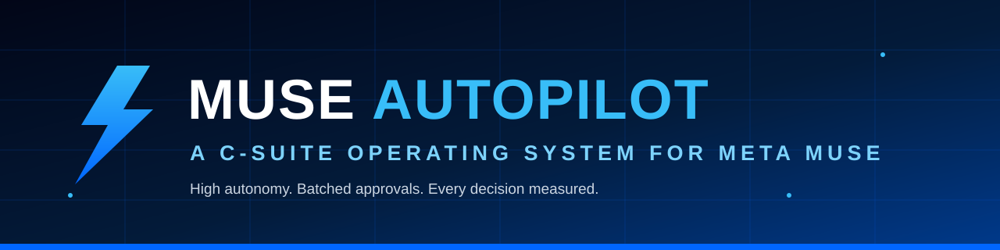
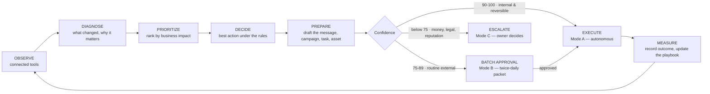

<p align="center">
  
</p>

<p align="center">
  
  
  
  
  
</p>

<p align="center">
  
</p>

<h3 align="center">A high-autonomy operating system for Meta Muse: a small AI C-suite that runs a business<br>on staged decisions and batched approvals instead of constant interruptions.</h3>

<p align="center">Very little approval. High-quality intelligent decisions. Strong growth. Controlled risk.<br>
<b>Reference deployment:</b> EDGE | AGENCY (Kevin Doherty, London, Ontario) — the business this blueprint was designed around, and the first live implementation.<br>
<b>Design goal:</b> automate <i>decisions</i>, not just tasks — one intelligent review window instead of dozens of interruptions.</p>

---

## The Skeleton

```
 CEO / CHIEF OF STAFF MUSE
 |
 +-- CMO / GROWTH MUSE ..... Market Intelligence · Content Factory · Campaign Analyst · Experiments
 +-- CRO / SALES MUSE ...... Lead Research · Qualification · Follow-up · Pipeline Forecast
 +-- COO / DELIVERY MUSE ... Onboarding · Project Health · Client Comms · Quality Control
 +-- CFO / FINANCE MUSE .... Cash Flow · Invoices & Collections · Margin · Expense Exceptions   (phase 2)
 +-- CTO / SYSTEMS MUSE .... Data Quality · Integration Health · Permissions · Dashboards        (phase 2)
```

Keep the C-suite **small**: one orchestrator plus narrow specialists. Too many agents means duplicated research, contradictory decisions, wasted tokens, unclear accountability. First 30 days activate only CEO, CMO, CRO and COO — CFO and CTO switch on once the core loop runs on clean data. The CEO owns priorities and conflicts; two execs never act against each other silently.

## Workflow Map



**The three autonomy modes**

| Mode | Rule | Examples |
|---|---|---|
| **A — Autonomous** | Internal, reversible, low-risk, in scope: just do it | Read & summarize, dedupe & score leads, internal tasks, drafts, reports, anomaly flags |
| **B — Batch approval** | Collected into one packet, ~9 AM & ~4 PM | Outreach sets, content publishing, small campaign tests, routine client follow-ups, standard proposals & invoices |
| **C — Mandatory approval** | Always stops for the owner | Spend above budget, refunds, legal terms, deletions, permission changes, non-standard promises, unverified claims |

**Confidence rule:** 90–100 executes inside policy · 75–89 goes in the batch · below 75 gets investigated or escalated.
**Evidence rule:** every consequential recommendation needs two independent signals (e.g. sales data + ad data), or it is labelled a hypothesis, not a fact.

## Contents

- **[blueprint.md](blueprint.md)** — the full design, section by section: the C-suite answer, the 8-stage operating principle, the low-approval autonomy model, decision thresholds, the org skeleton, the standard executive prompt skeleton, CEO/CMO/CRO/COO/CFO/CTO role specs, the Daily Control Room briefing format, the twice-daily batch approval packet, the Friday Weekly Executive Review, the knowledge-base folder tree, phased connector rollout for Muse, the 7 first routines, the 30-day launch plan (shadow mode days 8–14), OS metrics including agent quality, failure modes, and the CEO master instruction.
- **[setup-wizard.md](setup-wizard.md)** — the start-here questionnaire: seven screens — starting with **Screen 0: Bring Your Business With You** (website scan + uploads: leads CSV, customers CSV, price lists, invoices, documents, logo) that pre-fills the rest (Business, Money, Offers, Brand, Decision Limits, Tools & Priorities) whose answers generate the knowledge base, the money limits, and every executive's decision rights. Machine-readable set: [setup/questions.yaml](setup/questions.yaml).
- **[control-room-feature-plan.md](control-room-feature-plan.md)** — the Control Room dashboard feature plan (CEO overview, C-suite health, KPI reporting, Meta Ads view, approval queue, experiments tracker, delivery health) in the premium electric-blue design system.

## Standing rules

- Nothing executes without approval — and everything approved *executes*. Approvals are batched so the gate is one review window, not fifty interruptions.
- Electric blue is the brand default in every visual concept.
- No fabricated metrics, testimonials, customer details, or promises. Ever.
- Start read-only and draft-only; execution permissions are earned in shadow mode first.

<p align="center"><sub>Muse Autopilot — built for Meta Muse · Reference deployment: EDGE | AGENCY</sub></p>
